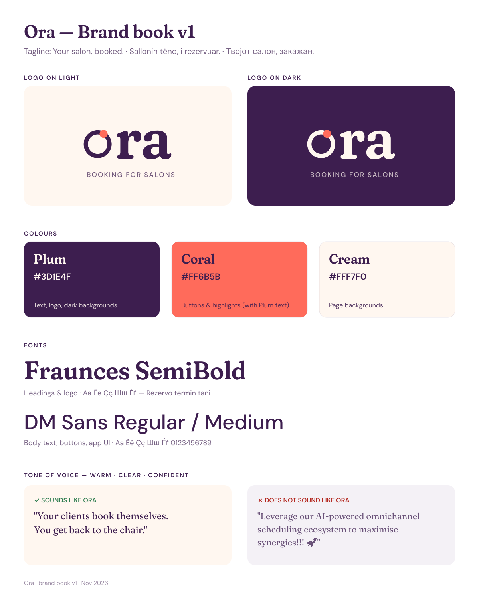

# Ora — Brand book v1 (Part 5)

## Name

**Ora**: Albanian for "the hour" (*ora*), which is exactly what a client is booking. It's short, easy to say in Albanian, Macedonian and English, and works as a lowercase logo.

### Availability check

Short names are often taken, so check these and write the result here:

| What | Where to check | Options to try, in order | Result |
|---|---|---|---|
| Domain | namecheap.com, marnet.mk (for .mk) | `ora.mk`, `getora.app`, `orabooking.com`, `ora-salon.com`, `ora-booking.com` | Others taken. **ora-booking.com available ✅** ($12.08/yr on Namecheap), chosen |
| Instagram | instagram.com/<handle> | `@ora.booking`, `@ora.salons`, `@getora.app` | **@ora.booking available ✅** (checked 15 Nov 2026: "Profile isn't available") |
| TikTok | tiktok.com/@<handle> | same as Instagram | **@ora.booking available ✅** (checked 15 Nov 2026: "Couldn't find this account") |
| Business email | after the domain | `hello@ora-booking.com` | Will be created after buying the domain |

**Backup names** if Ora is not available: **Radha** (Albanian "your turn", as in *e ke radhën*) or **Terminka** (from *termin*, used in both Albanian and Macedonian).

> Names I checked and rejected: "Rezervo" (RezervoNow and Rezzervo already exist) and "Termin…" names (TerminBooking, Terminland and Termino already exist).

## Tagline

- **English:** Your salon, booked.
- **Albanian:** Sallonin tënd, i rezervuar.
- **Macedonian:** Твојот салон, закажан.

## Logo

The **"o" in ora is a clock face**. The coral dot on the ring is the booked hour. It works as a full wordmark and as a small app icon.

| File | Use |
|---|---|
| `brand/logo-light.svg` / `.png` | Wordmark on light backgrounds |
| `brand/logo-dark.svg` / `.png` | Wordmark on dark backgrounds |
| `brand/icon-light.svg` / `.png` | App icon, favicon, Instagram profile picture (light) |
| `brand/icon-dark.svg` / `.png` | App icon, favicon, Instagram profile picture (dark) |
| `brand/brand-board.png` | This whole page as one image |

The wordmark is converted to outlines, so it looks the same on every computer, even without the fonts installed.

**Don't:** stretch the logo, change the dot colour, put it on busy photos, or add shadows.

## Colours

| Name | Hex | Use |
|---|---|---|
| **Plum** | `#3D1E4F` | Text, logo, dark backgrounds |
| **Coral** | `#FF6B5B` | Buttons, highlights, the "booked" dot |
| **Cream** | `#FFF7F0` | Page backgrounds |

**Accessibility:** Plum on Cream has a contrast ratio of 13.2:1 (excellent). On Coral buttons, **always use Plum text** (5.0:1). White text on Coral (2.8:1) is too weak to read and fails WCAG.

## Fonts (free, from Google Fonts)

| Font | Use |
|---|---|
| **Fraunces SemiBold** | Logo, headings |
| **DM Sans** Regular / Medium | Body text, buttons, the booking app |

Both support Albanian (ë, ç) and Macedonian Cyrillic.

## Tone of voice: **warm · clear · confident**

- **Warm:** we talk like a friendly person from the neighbourhood, not a corporation.
- **Clear:** short sentences. No tech words the salon owner doesn't use.
- **Confident:** we promise only what Ora really does, and we say it plainly.

✅ **Sounds like Ora:** "Your clients book themselves. You get back to the chair."

❌ **Does not sound like Ora:** "Leverage our AI-powered omnichannel scheduling ecosystem to maximise synergies!!! 🚀"
