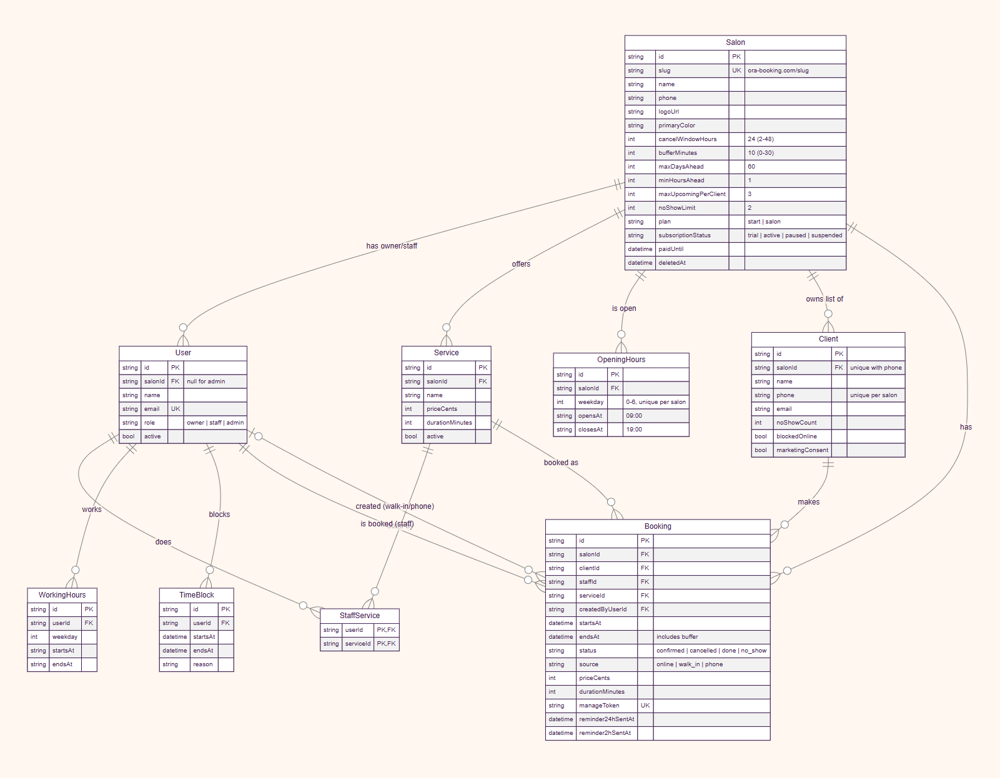
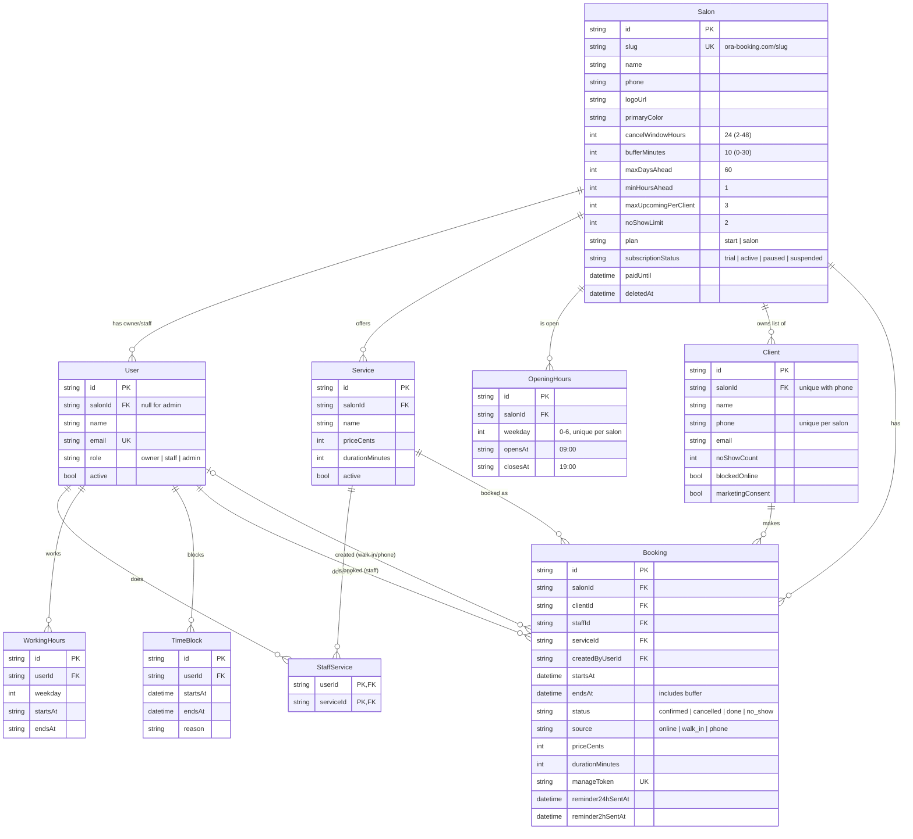

# Ora: Data model (Weekend 2)

The tables come from the roles, flows and 13 business rules in [`rules-and-flows.md`](rules-and-flows.md).
The source of truth is [`backend/prisma/schema.prisma`](../backend/prisma/schema.prisma), and the tables are created by the first migration, `backend/prisma/migrations/*_init/migration.sql`.



## The 9 tables in plain words

| Table | What one row is | Business rules it supports |
|---|---|---|
| **Salon** | One salon (one location in v1), with its branding, **booking rules** and **subscription** | 1, 3, 4, 5, 6 (rule settings), 11 (paused when unpaid), 12 (deleted after leaving) |
| **User** | Someone who logs in: **owner**, **staff** or the platform **admin** (admin has no salon) | Roles table, rule 7 |
| **Service** | Something the salon sells, e.g. "Gel nails, €15, 60 min" | Flow 1 step 4, rule 10 |
| **StaffService** | "This staff member does this service" (many-to-many) | Flow 1 step 5, Flow 2 step 3 |
| **OpeningHours** | When the salon is open on one weekday | Flow 1 step 3 |
| **WorkingHours** | When one staff member works on one weekday | Flow 2 step 4 (free slots) |
| **TimeBlock** | A break, day off or holiday for one staff member | Staff role ("block their own time") |
| **Client** | A person who books at **one** salon, identified by phone | 5 (no-show count, blocked), 8 (one phone = one client per salon), 13 (marketing consent) |
| **Booking** | One appointment: client + service + staff + time | 2, 4, 6, 9, Flows 2 and 3 |

## Design decisions (and why)

- **Clients have no account.** They're not in `User`. A client is a `Client` row per salon, found by phone number. `@@unique([salonId, phone])` enforces rule 8 in the database.
- **Booking rules live on `Salon`** (`cancelWindowHours`, `bufferMinutes`, `maxDaysAhead`, `minHoursAhead`, `maxUpcomingPerClient`, `noShowLimit`), with the defaults from the rules (24 h, 10 min, 60 days, 1 h, 3, 2). There's one set of settings per salon, so a separate table would only add a join.
- **`Booking.endsAt` includes the buffer** (service duration + `bufferMinutes`), so checking "is this slot free?" is a simple overlap check on `startsAt`/`endsAt`.
- **Price and duration are copied into the booking.** If the owner changes a price later, old bookings keep the price the client was shown (rule 10).
- **`manageToken`** is the secret in the cancel/reschedule link from the confirmation message (Flow 3), because clients have no password.
- **Reminders** are tracked with `reminder24hSentAt` / `reminder2hSentAt` (rule 9), so a reminder is never sent twice.
- **Nothing important is hard-deleted.** Services have `active`, bookings get `status = cancelled`, and salons get `deletedAt` with removal within 30 days (rules 11 and 12, owner stays in control).
- **Status fields are text**, because SQLite has no enum type. The allowed values are:
  - `User.role`: `owner` · `staff` · `admin`
  - `Booking.status`: `confirmed` · `cancelled` · `done` · `no_show`
  - `Booking.source`: `online` · `walk_in` · `phone`
  - `Salon.plan`: `start` · `salon`; `Salon.subscriptionStatus`: `trial` · `active` · `paused` · `suspended`
- **Money is in cents** (`priceCents = 1500` means €15.00) to avoid rounding errors.

## Known limitation (honest note)

**Rule 2 ("never double-booked")** can't be fully guaranteed by a database constraint, because SQLite has no "no overlapping time ranges" constraint. When the booking feature is built, it must check for overlaps **and** insert the booking **inside one transaction**. The index on `(staffId, startsAt)` keeps that check fast. Rules 3, 5 and 6 are also checked in code at booking time, using the numbers stored on `Salon`.

## Diagram (Mermaid, rendered by GitHub)



## DBML (paste into [dbdiagram.io](https://dbdiagram.io/d))

```dbml
Table Salon {
  id varchar [pk]
  name varchar [not null]
  slug varchar [unique, not null, note: 'ora-booking.com/<slug>']
  address varchar
  city varchar
  phone varchar [not null]
  email varchar
  logoUrl varchar
  coverPhotoUrl varchar
  primaryColor varchar
  accentColor varchar
  cancelWindowHours int [default: 24, note: 'rule 1, 2-48']
  bufferMinutes int [default: 10, note: 'rule 4, 0-30']
  maxDaysAhead int [default: 60]
  minHoursAhead int [default: 1]
  maxUpcomingPerClient int [default: 3]
  noShowLimit int [default: 2]
  plan varchar [default: 'start', note: 'start | salon']
  subscriptionStatus varchar [default: 'trial', note: 'trial | active | paused | suspended']
  trialEndsAt datetime
  paidUntil datetime
  deletedAt datetime
  createdAt datetime
  updatedAt datetime
}

Table User {
  id varchar [pk]
  salonId varchar [ref: > Salon.id, note: 'null for platform admin']
  name varchar [not null]
  email varchar [unique, not null]
  phone varchar
  role varchar [not null, note: 'owner | staff | admin']
  active boolean [default: true]
  createdAt datetime
  updatedAt datetime
}

Table Service {
  id varchar [pk]
  salonId varchar [ref: > Salon.id, not null]
  name varchar [not null]
  description varchar
  priceCents int [not null]
  durationMinutes int [not null]
  active boolean [default: true]
  createdAt datetime
  updatedAt datetime
}

Table StaffService {
  userId varchar [ref: > User.id]
  serviceId varchar [ref: > Service.id]
  indexes { (userId, serviceId) [pk] }
}

Table OpeningHours {
  id varchar [pk]
  salonId varchar [ref: > Salon.id, not null]
  weekday int [not null, note: '0 = Sunday ... 6 = Saturday']
  opensAt varchar [not null]
  closesAt varchar [not null]
  indexes { (salonId, weekday) [unique] }
}

Table WorkingHours {
  id varchar [pk]
  userId varchar [ref: > User.id, not null]
  weekday int [not null]
  startsAt varchar [not null]
  endsAt varchar [not null]
}

Table TimeBlock {
  id varchar [pk]
  userId varchar [ref: > User.id, not null]
  startsAt datetime [not null]
  endsAt datetime [not null]
  reason varchar
  createdAt datetime
}

Table Client {
  id varchar [pk]
  salonId varchar [ref: > Salon.id, not null]
  name varchar [not null]
  phone varchar [not null]
  email varchar
  noShowCount int [default: 0]
  blockedOnline boolean [default: false]
  marketingConsent boolean [default: false]
  notes varchar
  createdAt datetime
  updatedAt datetime
  indexes { (salonId, phone) [unique] }
}

Table Booking {
  id varchar [pk]
  salonId varchar [ref: > Salon.id, not null]
  clientId varchar [ref: > Client.id, not null]
  staffId varchar [ref: > User.id, not null]
  serviceId varchar [ref: > Service.id, not null]
  startsAt datetime [not null]
  endsAt datetime [not null, note: 'duration + buffer']
  status varchar [default: 'confirmed', note: 'confirmed | cancelled | done | no_show']
  source varchar [default: 'online', note: 'online | walk_in | phone']
  priceCents int [not null]
  durationMinutes int [not null]
  manageToken varchar [unique, not null]
  createdByUserId varchar [ref: > User.id]
  cancelledAt datetime
  reminder24hSentAt datetime
  reminder2hSentAt datetime
  createdAt datetime
  updatedAt datetime
  indexes {
    (staffId, startsAt)
    (salonId, startsAt)
    clientId
  }
}
```
